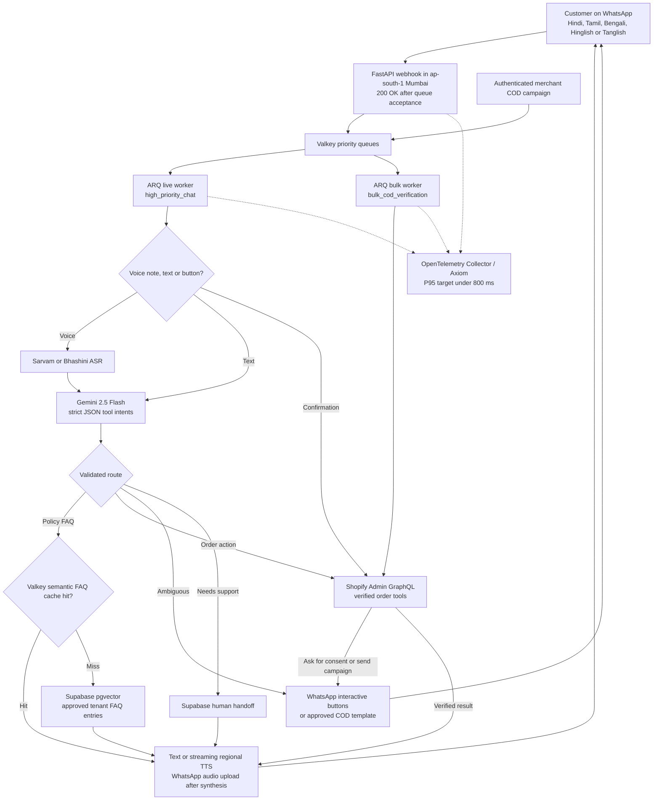

# BhashaCart AI

BhashaCart AI handles WhatsApp support, cash-on-delivery (COD) confirmation, and return requests for Indian Shopify D2C stores. It accepts Hindi, Tamil, Bengali, English, and code-switched Hinglish and Tanglish text and voice notes. Merchant-initiated COD verification helps reduce avoidable return-to-origin (RTO) shipments before dispatch.

## Architecture

The FastAPI webhook authenticates Meta deliveries and acknowledges them after Valkey accepts the jobs. The Mumbai deployment design reserves live-chat worker capacity separately from bulk COD. Customer replies to COD campaign buttons enter the live queue.



## Latency budget

The **under-800 ms P95 target** is a warm-path design budget. The numbers are engineering allocations. Measure the complete path independently because hop percentiles do not compose into an end-to-end percentile.

| Hop | Target | Measurement scope |
| --- | ---: | --- |
| Webhook + queue | <30 ms | Authenticate, parse, deduplicate and enqueue |
| Sarvam ASR | ~220 ms | Voice transcription after media download |
| Gemini Flash TTFT | ~280 ms | Request start to first nonempty streamed JSON fragment |
| Shopify GraphQL | ~120 ms | One successful Admin API request |
| TTS first chunk | ~120 ms | Start of streaming synthesis to first audio bytes |
| Nominal route allocation | ~770 ms | Leaves ~30 ms against the 800 ms target |

Queue dwell, Meta media download and upload, full JSON completion, FAQ embedding and retrieval, Shopify throttling, complete TTS synthesis and WhatsApp delivery can add latency. WhatsApp audio is sent after the clip is synthesized and uploaded. Track actual user-facing latency separately from first audio bytes. See [architecture and operations](ARCHITECTURE.md).

## Setup

### 1. Configure credentials and stores

Use Docker with Compose v2.24 or later. The setup commands use Bash syntax and also work in Git Bash on Windows. A direct Python setup requires Python 3.11+ and Valkey. Install FFmpeg for either Bhashini speech adapter when running outside Docker.

Copy `.env.example` to `.env` and set the Meta webhook secret and verification token, Gemini API key, Sarvam API key, and Supabase database DSN. Populate `STORES_JSON` with an object keyed by each WhatsApp phone number ID. Each entry carries the database `store_id`, the Shopify `*.myshopify.com` domain and Admin API token, WhatsApp sender token, an independent bulk API token, and the store locale. Set the exact COD gateway names returned by that store. Keep provider tokens and the DSN in a secret manager for deployment.

The scaffold defaults to `gemini-2.5-flash`. Google limits access to existing users before December 1, 2026 and will route that model ID to Gemini 3.5 Flash-Lite starting December 1. Set `GEMINI_MODEL=gemini-3.5-flash-lite` for new deployments or before switching an existing deployment. [Gemini 2.5 Flash model lifecycle](https://ai.google.dev/gemini-api/docs/models/gemini-2.5-flash)

For Shopify order and return operations, grant `read_orders`, `write_orders`, `read_returns`, and `write_returns` as applicable. Verify the store's protected customer data approvals for order phone fields. Enable `read_all_orders` separately if the merchant needs orders beyond Shopify's default access window. [Shopify API access scopes](https://shopify.dev/docs/api/usage/access-scopes)

Sarvam provides automatic language detection, code-mixed transcription, and streaming TTS. Set `ASR_PROVIDER=bhashini` and `BHASHINI_ASR_SERVICES` to select Bhashini transcription. Optionally set `TTS_PROVIDER=bhashini` and `BHASHINI_TTS_SERVICES` for batch synthesis. Both Bhashini adapters use the configured compute callback URL, auth header, and inference credential. Service IDs are keyed by `hi`, `ta`, `bn`, or `en`. [Sarvam ASR](https://docs.sarvam.ai/api-reference/speech-to-text/transcribe), [Bhashini compute requests](https://dibd-bhashini.gitbook.io/bhashini-apis/pipeline-compute-call/request-payload), [Sarvam streaming TTS](https://docs.sarvam.ai/api/api-guides-tutorials/text-to-speech/streaming-api/http-stream)

### 2. Provision Supabase Postgres

Run the migration once with an administrative DSN for a Supabase PostgreSQL 15+ project. The migration installs pgvector and creates the app's least-privilege group role and RLS policies. [Supabase pgvector](https://supabase.com/docs/guides/database/extensions/pgvector)

```bash
psql "$MIGRATION_DSN" -v ON_ERROR_STOP=1 -f supabase/migrations/001_init_schema.sql
```

From an administrator's psql session, create the application login and register each store. Replace the example UUID with the exact ID used in `STORES_JSON`. Supply the generated database password when `\password` prompts.

```sql
CREATE ROLE bhashacart_runtime LOGIN NOSUPERUSER NOBYPASSRLS IN ROLE bhashacart_app;
\password bhashacart_runtime
INSERT INTO public.stores (store_id, display_name)
VALUES ('a2a719aa-e76b-4f92-9070-6ce53a33beb9', 'Example D2C store');
```

Set `SUPABASE_POSTGRES_DSN` to the runtime login's TLS DSN. Use a provider-supported direct or session-pooled connection. Seed `public.faqs` with approved questions and answers for each store, locale, and topic. For the default `gemini-embedding-001` model, generate each question vector with `task_type=RETRIEVAL_DOCUMENT` and `output_dimensionality=768`. Save the model name with each row. FAQ questions query the same model and dimensions. [Gemini embeddings](https://ai.google.dev/gemini-api/docs/embeddings)

### 3. Start the services

```bash
docker compose config --quiet
docker compose up --build -d
docker compose ps
curl --fail http://localhost:8000/healthz
curl --fail http://localhost:8000/readyz
```

Compose starts `api`, `worker-live`, `worker-bulk`, `valkey`, and `otel-collector`. The API binds to localhost by default. In deployment, place the API behind a TLS ingress and expose `/webhooks/whatsapp` to Meta. Subscribe the Meta app to the WhatsApp `messages` field. In Meta App Dashboard, register the public HTTPS webhook URL with the same `WHATSAPP_VERIFY_TOKEN`. [Meta Cloud API webhooks](https://developers.facebook.com/docs/whatsapp/cloud-api/webhooks/)

For local Python development, use Linux, macOS or WSL for the workers. Start Valkey and set `VALKEY_URL` to an address reachable from the host. Install the package, then run each server command in its own terminal.

```bash
python -m pip install -e .
uvicorn app.main:app --port 8000 --no-access-log
arq app.worker.LiveWorkerSettings
arq app.worker.BulkWorkerSettings
```

Use `uv sync --locked` for a locked Python environment and prefix server commands with `uv run` when using uv. Omit the Meta verification query string from ingress access logs.

### 4. Enqueue a COD verification

Configure an approved WhatsApp template with one positional body variable for the order number and a quick-reply confirmation at button index `0`. Set `cod_template` and `cod_template_language` on the store. Submit one opted-in recipient/order pair per request and reuse the same campaign ID for retries.

```bash
curl --fail-with-body -X POST "http://localhost:8000/internal/cod/${PHONE_NUMBER_ID}" \
  -H "Authorization: Bearer ${BULK_API_TOKEN}" \
  -H "Content-Type: application/json" \
  -d '{"campaign_id":"diwali-2026","order_name":"#1042","recipient":"919876543210","opted_in":true}'
```

The bulk worker checks that the recipient owns the order, the order qualifies for COD, and the template is configured. The customer taps the confirmation button before the worker can add `bhashacart-cod-confirmed` in Shopify. Connect fulfillment workflows to that tag in the merchant's own Shopify setup.

### 5. Verify a deployment

Send a text tracking request for an owned test order, a regional voice note, and a deliberately ambiguous request. Redeliver the same signed webhook and check that it produces one job. Send a test COD campaign, tap its confirmation twice, and inspect the Shopify tag and database action ledger. Review handoff rows from a trusted merchant support workflow.

Set `OTEL_COLLECTOR_CONFIG=./otel-collector.axiom.yml` and configure `AXIOM_DOMAIN`, `AXIOM_API_TOKEN`, `AXIOM_TRACES_DATASET`, and `AXIOM_METRICS_DATASET` to ship telemetry to Axiom. The default collector uses a local debug exporter.

## Repository map

| Path | Responsibility |
| --- | --- |
| `app/main.py` | Meta verification, signed event intake, deduplication, bulk enqueue |
| `app/worker.py` | Independent ARQ live chat and bulk COD worker settings |
| `app/schemas.py` | Webhook validation and strict tool intent and input models |
| `app/ai_orchestrator.py` | Transcription, tool routing, FAQ grounding, confirmation and TTS |
| `app/shopify_client.py` | Allowlisted GraphQL operations, ownership and throttling |
| `app/whatsapp.py` | Media download/upload, template, interactive and text replies |
| `app/repository.py` | Tenant-scoped retrieval, handoffs and mutation ledger |
| `app/config.py` and `.env.example` | Settings and per-store credentials |
| `app/telemetry.py` and `otel-collector*.yml` | OpenTelemetry histogram, traces and exporters |
| `supabase/migrations/001_init_schema.sql` | Store schema, pgvector, runtime grants and RLS |
| `pyproject.toml`, `uv.lock`, `Dockerfile`, `docker-compose.yml` | Package and services |
